# 8×8 Systolic Array CNN Accelerator with Fused Post-Processing

An 8×8 weight-stationary systolic array in Verilog RTL for CNN inference, with a
fused post-processing pipeline that applies bias, activation, quantisation and
pooling to the array output on its way into the on-chip output buffer. This
avoids a separate pass over memory for each post-processing step.

> Module names keep the original `nmu` / `near_memory_*` prefixes ("NMU-In" =
> input buffers, "NMU-Out" = post-processing + output buffer).

- **Language / tools:** Verilog-2001, Xilinx Vivado, Icarus Verilog
- **FPGA:** Zynq-7000 XC7Z020 (`xc7z020clg400-1`, PYNQ-Z2), synthesised and implemented in Vivado 2024.2
- **Verification:** three self-checking testbenches with golden reference models.
  Core regression: 26 / 26 tests, 4,892 output checks, 0 errors.
- **Results:** 56 cycles per 512-MAC tile, 1.76× fewer cycles and 64 → 0
  intermediate SRAM transactions per tile vs. an unfused baseline, 18% LUT and
  6% BRAM on the XC7Z020, timing met at 100 MHz (WNS +0.898 ns), 0.176 W.
- **SoC:** AXI4-Lite control + AXI4-Stream data wrapper with an AXI DMA block
  design for the Zynq PS, and a bare-metal C driver (not yet run on the board).

---

## Architecture

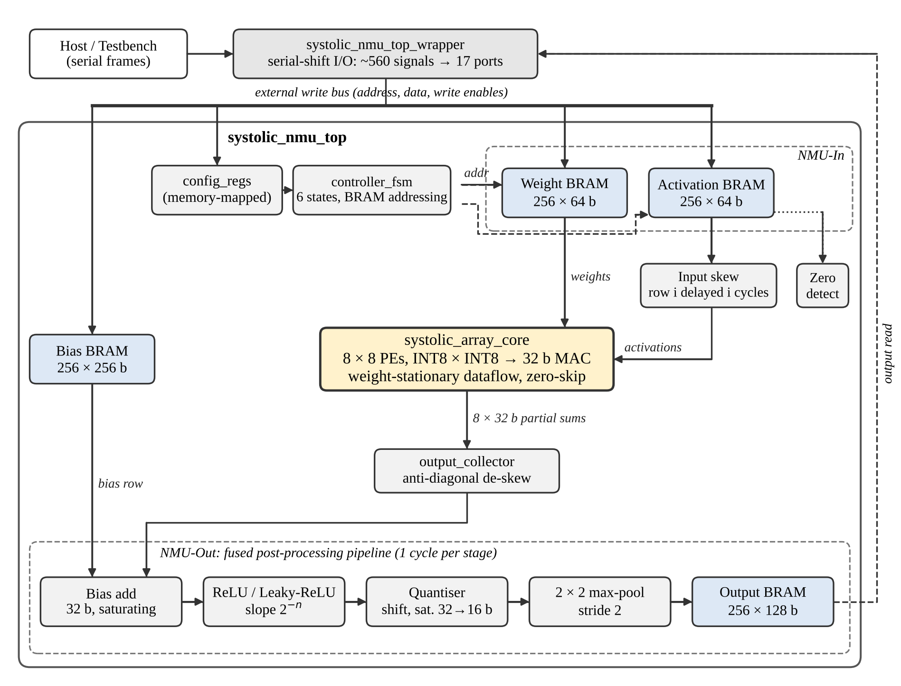

### Dataflow

1. **Load weights** (8 cycles). The FSM reads the weight BRAM one row at a time
   and shifts each row down into the PE grid. Each PE then holds its weight.
   The bias read pointer is set to `BIAS_BASE_ADDR` in the same phase.
2. **Load bias** (8 cycles). Wait state with no data movement.
3. **Stream activations** (15 cycles). Activation vectors are read from BRAM and
   skewed diagonally (row *i* is delayed by *i* cycles). They move left to
   right, and partial sums move top to bottom.
4. **Compute / drain** (8 + 15 cycles). The output collector de-skews the
   anti-diagonal results, and each row goes through the NMU-Out pipeline into
   the output BRAM.

One 8×8 × 8×8 tile (512 MACs) takes **56 clock cycles** from start to done.

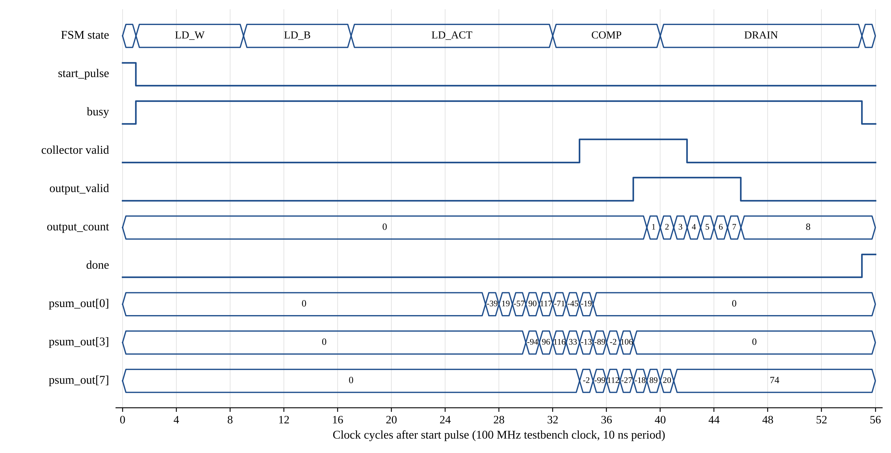

*Timing of one tile (Test 3), reconstructed from the per-cycle simulation log.
Partial sums leave the array along anti-diagonals and the first post-processed
row is written at cycle 38.*

### Processing element

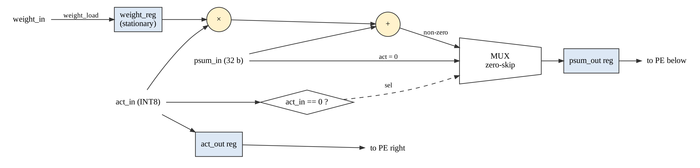

Each PE holds one INT8 weight and computes `psum_out = psum_in + w × act_in`.
When `act_in` is zero the MAC is skipped and `psum_in` passes through unchanged.

### Fused post-processing pipeline

```
psum (32b) → +bias (32b, saturating) → ReLU / Leaky-ReLU (32b) → >>> shift, saturate (16b) → 2×2 max-pool (16b) → Output BRAM
```

| Stage | Detail |
|---|---|
| Bias add | Per-element 32-bit add with saturation; one bias row per output row |
| Activation | 0 = bypass, 1 = ReLU, 2 = Leaky ReLU (negative slope = 2^-`LEAKY_SHIFT`) |
| Quantiser | Arithmetic right-shift by `QUANTIZE_SHIFT` (0–15), saturating clip 32 → 16 bit |
| Pooling | Optional 2×2 max-pool, stride 2: 8×8 → 4×4 (4 output rows) |

Each stage is a 1-cycle registered pipeline stage.

---

## On-chip memory

Each memory is written as a Verilog array with `(* ram_style = "block" *)`. Vivado
maps it to Block RAM.

| Memory | Location | Organisation | Contents |
|---|---|---|---|
| Weight BRAM (A/B) | `near_memory_input.v` | 2 × 256 × 64 bit | word *k* = 8 INT8 weights of row *k* |
| Activation BRAM (A/B) | `near_memory_input.v` | 2 × 256 × 64 bit | word *m* = 8 INT8 activations |
| Bias BRAM | `systolic_nmu_top.v` | 256 × 256 bit | word *m* = 8 × 32-bit biases |
| Output BRAM | `near_memory_output.v` | 256 × 128 bit | word *m* = 8 × 16-bit results |

All reads are synchronous, with 1-cycle latency. The input memories have A/B
banks selected by `buffer_swap`; the FSM does not toggle it yet, so loading and
compute do not overlap in this version.

---

## Module hierarchy

| Module | File | Description |
|---|---|---|
| `systolic_nmu_top_wrapper` | `rtl/systolic_nmu_top_wrapper.v` | Serial-shift I/O wrapper (~560 core signals → 17 ports) |
| `systolic_nmu_top` | `rtl/systolic_nmu_top.v` | Top-level integration, input skew, bias BRAM |
| `config_regs` | `rtl/config_regs.v` | Memory-mapped configuration registers |
| `controller_fsm` | `rtl/controller_fsm.v` | 6-state control FSM, BRAM address generation |
| `near_memory_input` | `rtl/near_memory_input.v` | Weight + activation BRAM, zero detection |
| `sram_bank` | `rtl/sram_bank.v` | Parameterised simple-dual-port BRAM |
| `systolic_array_core` | `rtl/systolic_array_core.v` | N×N PE grid |
| `pe` | `rtl/pe.v` | Weight-stationary MAC with zero-skip |
| `output_collector` | `rtl/output_collector.v` | Anti-diagonal de-skew |
| `near_memory_output` | `rtl/near_memory_output.v` | Post-processing pipeline + output BRAM |
| `bias_adder` | `rtl/bias_adder.v` | Saturating bias addition |
| `activation_unit` | `rtl/activation_unit.v` | ReLU / Leaky ReLU |
| `quantizer` | `rtl/quantizer.v` | Shift + saturating 32 → 16-bit quantisation |
| `pooling_unit` | `rtl/pooling_unit.v` | 2×2 max-pooling, stride 2 |
| `performance_counters` | `rtl/performance_counters.v` | Six saturating 32-bit counters |
| `systolic_baseline_top` | `rtl/systolic_baseline_top.v` | Unfused baseline: same core, post-processing in 4 SRAM passes |
| `baseline_multipass_fsm` | `rtl/baseline_multipass_fsm.v` | 11-state FSM for the baseline passes |
| `axi_nmu_wrapper` | `rtl/axi_nmu_wrapper.v` | AXI4-Lite slave + AXI4-Stream slave/master, `irq_done` |

## Parameters

| Parameter | Default | Description |
|---|---|---|
| `ARRAY_SIZE` | 8 | N×N array dimension |
| `DATA_WIDTH` | 8 | Signed operand width |
| `ACC_WIDTH` | 32 | Accumulator width |
| `OUTPUT_WIDTH` | 16 | Quantised output width |
| `SRAM_DEPTH` | 256 | Words per BRAM |
| `ADDR_WIDTH` | 8 | BRAM address width |

## Configuration registers

| Addr | Name | Bits | Function |
|---|---|---|---|
| 0 | `START` | [0] | Write 1 to start a run (single-cycle pulse) |
| 1–3 | `MATRIX_M/K/N_SIZE` | [15:0] | Stored and readable; each run currently computes one 8×8 tile |
| 4 | `ACTIVATION_MODE` | [1:0] | 0 = bypass, 1 = ReLU, 2 = Leaky ReLU |
| 5 | `POOLING_ENABLE` | [0] | Enable 2×2 max-pooling |
| 6 | `QUANTIZE_SHIFT` | [3:0] | Right-shift before 16-bit saturation |
| 7 | `LEAKY_SHIFT` | [3:0] | Leaky-ReLU slope = 2^-shift |
| 8 | `BIAS_BASE_ADDR` | [15:0] | First bias BRAM row for this run |
| 9 | `PERF_TOTAL_CYCLES` | [31:0] | Cycles with `busy` high (read-only) |
| 10–11 | `PERF_SRAM_RD/WR` | [31:0] | Intermediate SRAM reads / writes (0 by construction in the fused design) |
| 12 | `PERF_COMPUTE_CYCLES` | [31:0] | Cycles with `compute_enable` high |
| 13 | `PERF_STALL_CYCLES` | [31:0] | Stall cycles |
| 14 | `PERF_ZERO_SKIP` | [31:0] | Compute cycles in which at least one array row gets a zero activation |

## FSM

```
IDLE → LOAD_WEIGHTS → LOAD_BIAS → LOAD_ACT → COMPUTE → DRAIN → IDLE
```

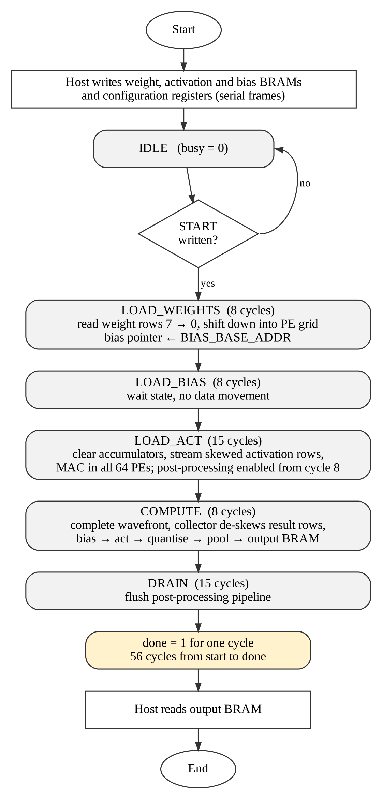

---

## Verification

`tb/tb_systolic_nmu_wrapper.v` drives the design through the serial wrapper.
It checks every output against a behavioural reference model:

```
out[m][j] = pool( sat16( act( Σk A[m][k]·W[k][j] + B[m][j] ) >>> qshift ) )
```

It also checks PE weight registers, config decoding, single-cycle strobes,
`done` / `output_valid` counts and that the design never restarts on its own.

| Test | Covers |
|---|---|
| 1–2 | Reset state, serial config path, strobe width |
| 3–5 | Identity, all-ones and counting-pattern matrices |
| 6–7 | Random signed data, extreme values, saturation |
| 8 | Bias/row alignment, random bias |
| 9–10 | ReLU, Leaky ReLU (two slopes) |
| 11 | Quantisation shift sweep (0, 1, 8, 15) |
| 12 | 2×2 max-pooling |
| 13 | Sparse / all-zero activations and weights (zero-skip) |
| 14 | Three back-to-back runs without reset |
| 15 | Non-zero bias base address with guard rows |
| 16 | Reset asserted mid-compute, then recovery |
| 100–109 | Randomised regression (random activation, shifts, pooling, bias base) |

**Result:** 26 / 26 tests passed, 4,892 checks, 0 errors.

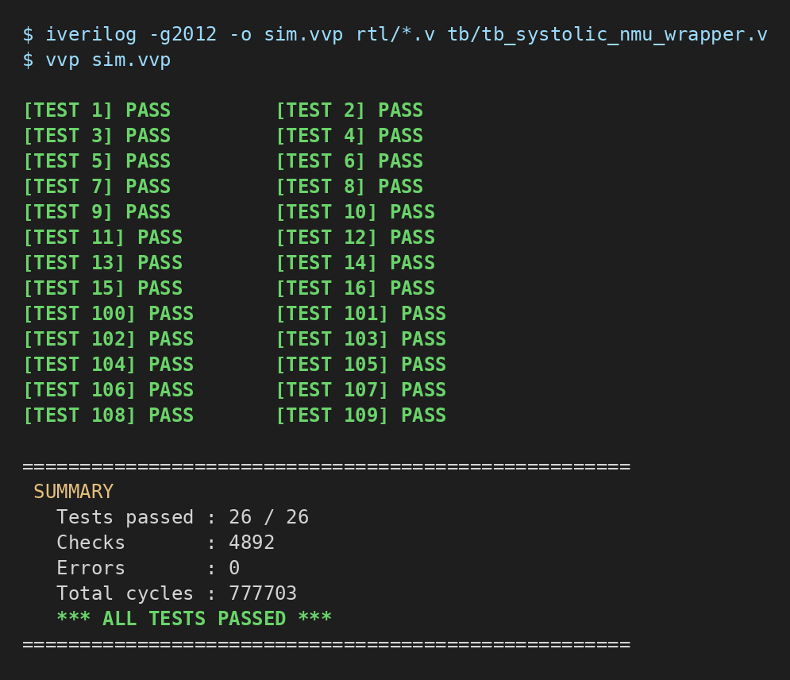

### Test results

| Result | Image |
|---|---|
| Test 3: identity weights, output must equal the activation matrix | [test03_identity_weights.jpg](docs/images/test03_identity_weights.jpg) |
| Test 6: random signed data, quantisation shift 0, outputs saturate at −32768 / 32767 | [test06_random_signed_saturation.jpg](docs/images/test06_random_signed_saturation.jpg) |
| Test 12: ReLU + 2×2 max-pooling, 8×8 → 4×4 | [test12_maxpool_2x2.png](docs/images/test12_maxpool_2x2.png) |
| Test 13: sparse weights, alternate zero activation rows (zero-skip) | [test13_sparse_zero_skip.jpg](docs/images/test13_sparse_zero_skip.jpg) |
| Test 14: third back-to-back run, Leaky-ReLU, shift 4, random bias | [test14_leaky_relu_back_to_back.jpg](docs/images/test14_leaky_relu_back_to_back.jpg) |

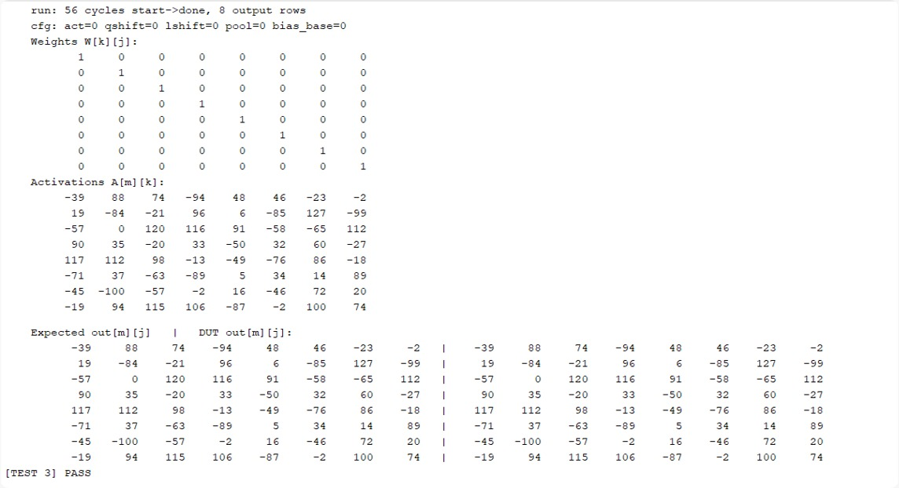

### Fused vs. unfused (A/B)

`tb/tb_ab_comparison.v` runs the fused design and the unfused baseline
(`systolic_baseline_top`) on the same inputs. Both are checked against a golden
model, and the hardware counters are read out.

| Metric (one 8×8 tile) | Baseline | Fused | |
|---|---|---|---|
| Busy cycles | 95 | 54 | 1.76× fewer |
| Intermediate SRAM reads | 32 | 0 | |
| Intermediate SRAM writes | 32 | 0 | |
| Compute-active cycles | 23 | 23 | same core |
| Output | bit-exact | bit-exact | |

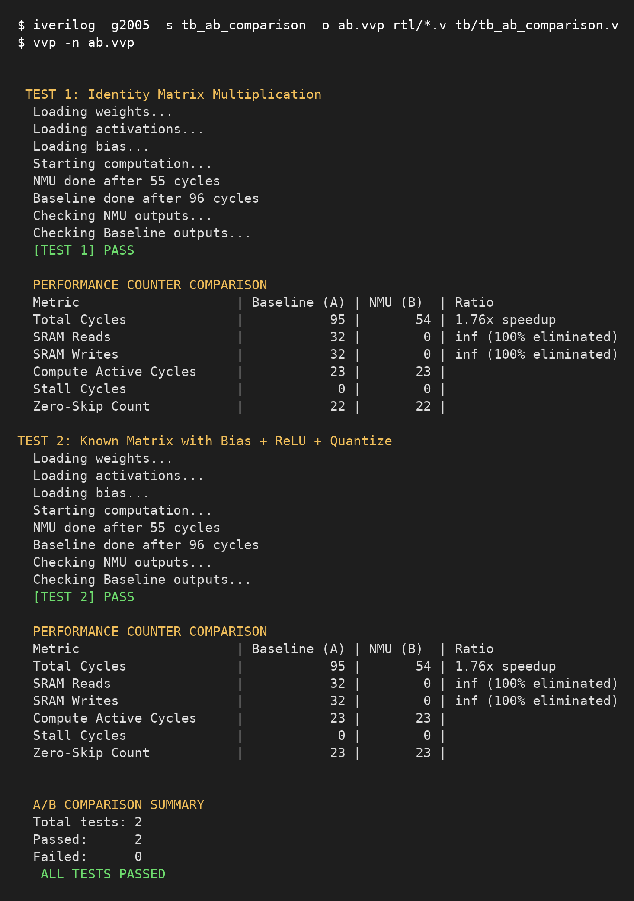

The baseline writes raw partial sums to an inter-stage SRAM and runs bias,
activation, quantisation and pooling as four passes of N+2 = 10 cycles each.
The fused design has no inter-stage SRAM, so its read/write counters are tied
to 0. (Busy cycles are 54; start to `done` at the pins is 56.)

### AXI wrapper

`tb/tb_axi_nmu.v` configures the core over AXI4-Lite, streams weights,
activations and biases in over AXI4-Stream (`tuser` = 00 weight, 01 activation,
10 bias), waits for `irq_done`, and checks every output row, `TLAST`,
`STATUS.done` and `OUTPUT_COUNT`.

---

## FPGA implementation (Zynq-7000 XC7Z020)

Synthesised and implemented in Vivado 2024.2 with `systolic_nmu_top_wrapper` as
top, a 100 MHz clock (200 ps uncertainty) and the Pblock floorplan in
`constraints/pblock_nmu_colocated.xdc`.

### Utilisation

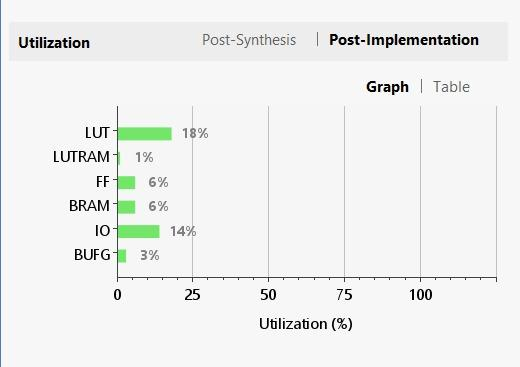

| Resource | Utilisation |
|---|---|
| LUT | 18% |
| LUTRAM | 1% (160 SRL16E in the input skew) |
| FF | 6% |
| BRAM | 6% (8 RAMB36) |
| IO | 14% (17 pins, serial wrapper) |
| BUFG | 3% (1) |

The 64 multipliers map to LUTs; no DSP48 slices are used.

### Timing

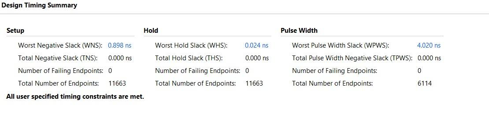

All constraints met at 100 MHz: WNS +0.898 ns, WHS +0.024 ns, WPWS +4.020 ns,
0 failing endpoints out of 11,663. `rst_n` and the quasi-static status pins
(`busy`, `done`, `output_valid`, `output_count`) are false-pathed; the serial
pins have 1.5 ns max I/O delay and `serial_out` is packed into the IOB.

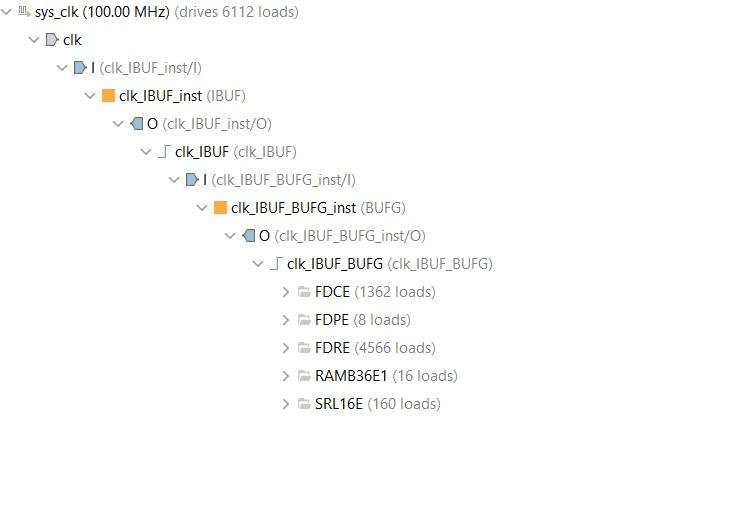

`sys_clk` goes IBUF → BUFG and drives 6,112 loads.

### Power

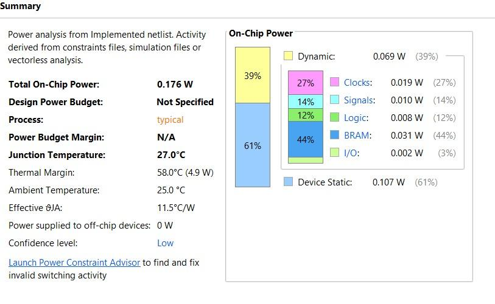

0.176 W total on-chip: 0.069 W dynamic, 0.107 W static. BRAM is the largest
dynamic component (0.031 W, 44%). The estimate is vectorless (confidence: Low).

### Floorplan

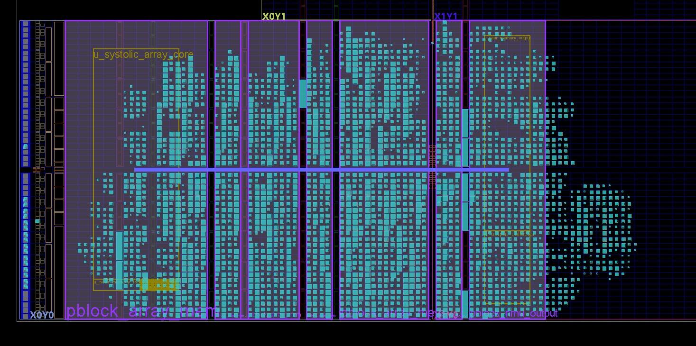

`pblock_array_mem` holds the systolic core, input BRAMs and skew registers;
`pblock_nmu_output` holds the collector, bias BRAM, post-processing pipeline and
output BRAM, next to it.

---

## Zynq SoC integration (block design)

`vivado_bd/nmu_bd.bd` connects `axi_nmu_wrapper` to the Zynq PS through an AXI
DMA (MM2S 256-bit, S2MM 128-bit) on HP0, with control on GP0. The C driver in
`drivers/` configures the registers, starts a run, polls `STATUS` and reads the
counters. This has been built in IP Integrator and simulated at the wrapper
level; it has not been run on the board yet.

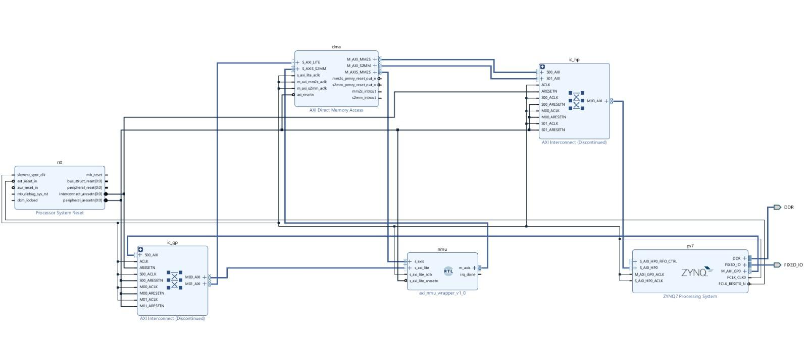

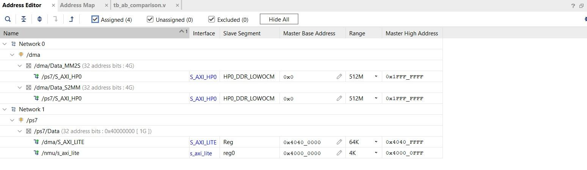

| Slave | Base | Range |
|---|---|---|
| NMU AXI4-Lite | `0x4000_0000` | 4 KB |
| AXI DMA control | `0x4040_0000` | 64 KB |
| DDR via HP0 | `0x0000_0000` | 512 MB |

Known gaps: the stock `axi_dma` MM2S port does not drive `tuser`, so the data
type has to come from a register or sideband instead; `irq_done` is not
connected to the PS (the driver polls); the driver has no DMA calls yet.

---

### Run with Icarus Verilog

```bash
iverilog -g2012 -s tb_systolic_nmu_wrapper -o sim.vvp rtl/*.v tb/tb_systolic_nmu_wrapper.v
vvp sim.vvp

iverilog -g2012 -s tb_ab_comparison -o ab.vvp rtl/*.v tb/tb_ab_comparison.v
vvp ab.vvp

iverilog -g2012 -s tb_axi_nmu -o axi.vvp rtl/*.v tb/tb_axi_nmu.v
vvp axi.vvp
```

### Run with Vivado

```bash
vivado -mode batch -source vivado_create_project.tcl   # creates vivado_project/
```

Or on Windows, run `open_in_vivado.bat`. The script targets `xc7z020clg400-1`
and sets `systolic_nmu_top_wrapper` as the top-level design and
`tb_systolic_nmu_wrapper` as the simulation top.

---

## Project structure

```
├── rtl/                           18 Verilog modules
├── tb/                            core regression, A/B comparison, AXI wrapper
├── constraints/
│   ├── systolic_nmu.xdc           100 MHz clock, I/O delays, false paths
│   └── pblock_nmu_colocated.xdc   Pblock floorplan
├── drivers/                       bare-metal C driver (ARM Cortex-A9)
├── vivado_bd/                     Zynq block design (nmu_bd) and IP configs
├── experimental/                  dual-tile and baseline AXI wrapper (not working yet)
├── docs/images/                   diagrams, waveform, test results, Vivado reports
├── vivado_create_project.tcl
└── open_in_vivado.bat
```

## Experimental

`experimental/dual_tile/` has two 4×4 tiles sharing one post-processing
pipeline through a round-robin arbiter. It is not functional yet: both tiles
start on the same pulse and drain in the same cycles, and with no per-tile
buffer the arbiter can only take one of them. `tb_dual_tile.v` is a smoke test
with no golden check. `experimental/axi_nmu_baseline_wrapper.v` is an AXI
wrapper for the baseline and has no testbench yet.
